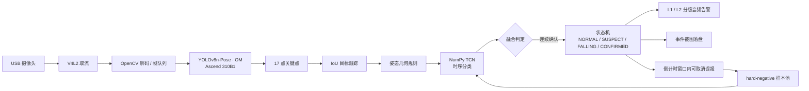

# 端侧跌倒检测 · Ascend 310B1

面向社区康复与居家照护的**端侧**跌倒检测系统。全部推理在本机 NPU 完成，视频与关键点不出设备。

针对这类系统"误报三次就被家属关掉"的现实，判定采用「姿态几何 → 目标跟踪 → 时序分类」三级结构，
并建立误报样本回流机制；工程侧配套自检、诊断与误报审计脚本，便于长期无人值守运行。

| 项 | 值 |
|---|---|
| 推理硬件 | Orange Pi AIpro 20T · Ascend 310B1 NPU |
| 运行时 | Ubuntu 22.04.3 LTS（aarch64）· CANN |
| 检测模型 | YOLOv8n-Pose，ONNX 12.9 MB → OM 7.4 MB |
| 时序模型 | 轻量 TCN，参数量 **100,290** |
| 端到端帧率 | **≈ 15 FPS**（界面实测 15.1–15.8） |
| 关键点 | 17 点（COCO），实时输出 |
| 数值一致性 | NumPy 推理实现与 PyTorch 输出最大差 **8.0e-07** |

> 数值一致性是刻意做的：端侧用 NumPy 重写了后处理，若不与训练侧对齐，
> "离线评估好看、上板就变差"会变成一个查不出来的坑。

---

## 架构



**为什么不是单个模型端到端**

单帧检测在"弯腰、坐下、蹲下"上误报率不可接受。拆成三层后每层只解决一个问题：

1. **几何规则**给先验：躯干角度、人体框长宽比，成本近零，先过滤明显正常的姿态；
2. **IoU 跟踪**解决多人串号：帧间 ID 稳定是时序判定的前提；
3. **TCN** 看时间维度："倒下去"和"蹲下去"单帧几乎同形，30 帧窗口里差别明显。

---

## 模块与文件

| 职责 | 文件 |
|---|---|
| 稳定单路入口 | `src/main_pose_safe.py` |
| 融合入口（含音频） | `src/main_pose.py` |
| 姿态解码 / NMS / 跟踪 / 几何规则 | `src/fall_ai/pose_fall_detector.py` |
| 规则 + TCN 融合、状态机 | `src/fall_ai/fall_engine.py` |
| 告警分级、确认/取消、样本回流 | `src/fall_ai/alarm_manager.py` |
| 数据采集（1=跌倒 / 2=非跌倒） | `src/fall_ai/collect_dataset.py` |
| TCN 训练 | `src/fall_ai/train_tcn.py`、`train_tcn_warm.py` |
| 数据集评估 | `src/fall_ai/eval_dataset.py` |
| 误报审计 / 复盘 | `src/fall_ai/fp_audit.py`、`analyze_fp.py`、`replay_fp.py` |
| 自检与诊断 | `src/fall_ai/doctor.sh`、`selftest.sh`、`selftest_detector.py` |
| 性能基准 | `src/fall_ai/bench_camera.py`、`bench_decode.py`、`bench_tcn.py` |
| 检测模型 | `models/目标检测模型/yolov8n_pose.om`（Git LFS） |
| 时序权重 | `models/时序分类模型/real/tcn_fall.npz` |
| 评估输出 | `reports/fall_accept/`（原始 JSON） |

---

## 快速开始

```bash
# 模型走 Git LFS，克隆后需拉取实体
git lfs install
git lfs pull

# 环境
source /usr/local/Ascend/ascend-toolkit/set_env.sh
export DISPLAY=:0

# 环境自检（摄像头、声卡、CANN、模型齐不齐）
bash src/fall_ai/doctor.sh

# 启动（默认静音；需要声音时设 REHAB_SILENT=0）
REHAB_SILENT=1 bash src/start.sh
```

停止并释放摄像头：

```bash
pkill -TERM -f '[m]ain_pose_safe.py'
fuser /dev/video0 /dev/video1
```

采集自己的数据：

```bash
python3 -u src/fall_ai/collect_dataset.py \
    --outdir ~/fall_dataset_round3 --duration 8 --fps 30
```

---

## 模型转换

```bash
atc --model=yolov8n-pose.onnx \
    --framework=5 \
    --output=yolov8n_pose \
    --soc_version=Ascend310B1
```

转换中出现算子不支持时，按「逐个映射为昇腾等价组合 → 重新转换 → 逐层输出比对」处理，
不走 CPU 回退绕过——那会吃掉帧率，还会把精度问题掩盖到线上。

---

## 评估

三档口径，**不能混着看**：

| 口径 | 样本 | 结果 |
|---|---|---|
| 时序分类器（训练窗口级） | 111 窗口 | recall 73.1% / precision 43.2% |
| 全链路视频回归（难负样本版） | 23 段（14 跌倒 / 4 硬负 / 5 正常） | 片段级 recall **50.0%**、负样本误报 **11.1%** |
| 全链路离线回归（早期） | 22 段 | **作废**：姿态输入为空（`det_events = 0`），非模型问题 |

**如实说明**：当前片段级召回 50%，主要原因是连续确认偏保守、部分跌倒片段关键点缺失。
这是工程原型不是成品，下一步重点提升召回，而不是继续压误报。

评估脚本：`src/fall_ai/eval_dataset.py`、`accept_run.py`；原始输出可按 `reports/` 复现。

---

## 已知限制

- 单路摄像头；多路并发未做压力测试
- 夜间与逆光下关键点丢失明显，召回下降
- TCN 窗口固定 30 帧，跨窗口的慢速跌倒可能漏检
- 依赖 CANN 运行时版本，跨版本未验证

---

## 目录

```text
src/          主程序、fall_ai 子模块、自检与评估脚本
models/       检测模型（OM，Git LFS）、时序权重、模型清单
reports/      评估 JSON、运行日志与事件截图
docs/         项目总览、部署说明、算法模块说明、交接入口
experiments/  训练与调参记录（非正式版本）
```

更多细节见 `docs/算法模块README.md` 与 `docs/昇腾派运行说明.md`。

---

## 授权

见 `LICENSE`。
